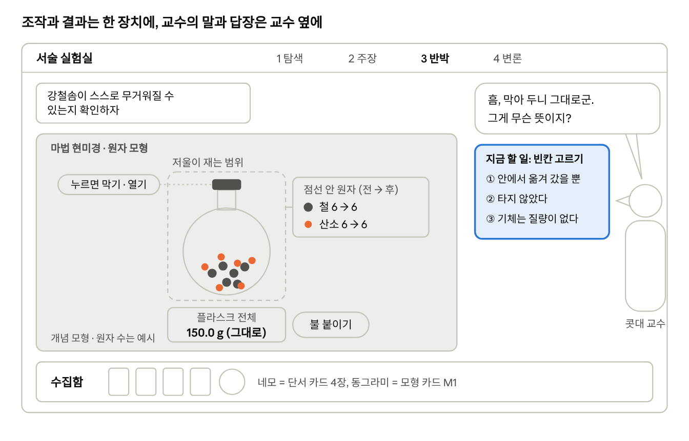
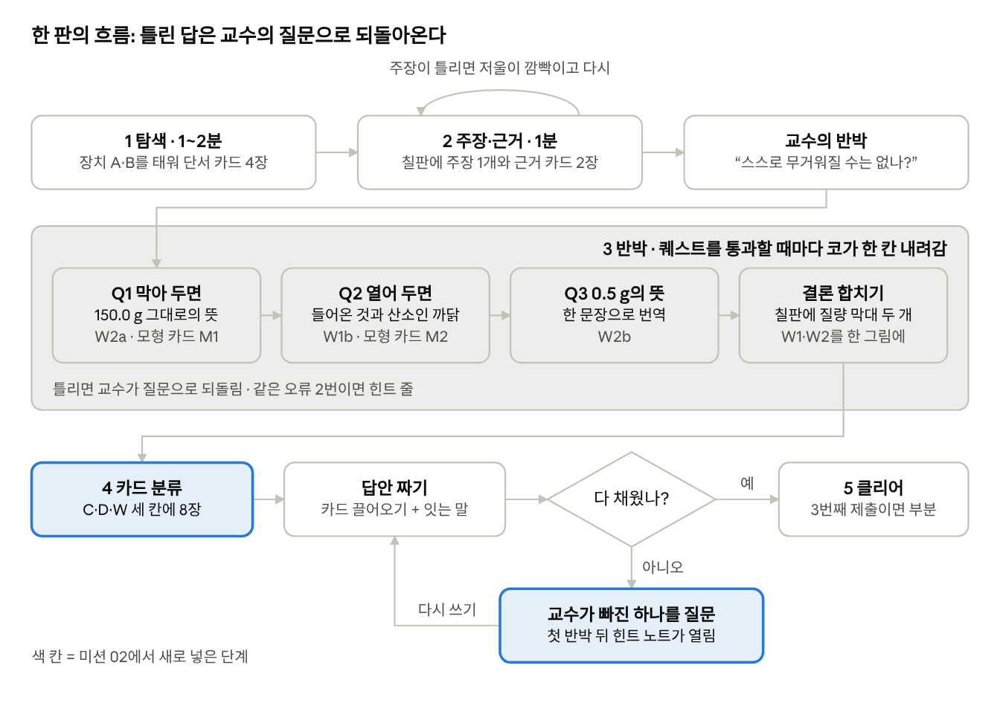

# 서술 실험실 PRD — 미션 02 「강철솜」 (초안)

> 원본(편집용 Claude 문서): https://claude.ai/artifact/J1EJS2YLop99YhupMrfRU2 — 이 파일은 2026-10-30에 내보낸 사본이다. 그림 두 장은 `design/`에 있다.

Oct 30, 2026 · @Cameleong

## 1. 개요

미션 02는 중3 문항 8 「늘어난 강철솜」을 9\~12분짜리 한 판 게임으로 옮긴다. 학생은 늘어난 0.5 g과 그대로인 150.0 g이라는 두 숫자를 각각 "바깥에서 산소가 들어와 결합했다", "안에서 옮겨 갔을 뿐이다"로 번역해 쓰게 된다. 뼈대는 미션 01(감자 삼투)을 그대로 쓰고, 미션 01 시연 피드백 세 가지를 반영해 최종 답안 쓰기, 다음 단계 안내, 화면 배치를 고친다.

**문항.** 과학3 Ⅰ-2-01 「화학 반응에서 보존되는 질량」(비상교육 24\~27쪽) · 성취기준 \[9과16-03\] 화학 반응에서 질량이 보존됨을 실험을 통해 추론할 수 있다.

| 측정한 것 | 반응 전 | 반응 후 |
| --- | --- | --- |
| 실험 A: 강철솜(남은 물질)의 질량 · 실험 접시에 올려 공기 중에서 태움 | 2.0 g | 2.5 g |
| 실험 B: 플라스크 전체의 질량 · 산소가 충분한 플라스크에 넣고 마개를 막은 뒤 전기로 불을 붙임 | 150.0 g | 150.0 g |

문제: "실험 A에서 강철솜을 태운 뒤 질량이 증가한 까닭을 쓰고, 그렇게 판단한 근거를 실험 결과를 이용하여 설명하시오."

**해결하려는 문제.** 학생은 주장(C: 산소와 결합)과 자료(D)는 가져오지만, 그 숫자가 무엇을 뜻하는지(W)는 비워 둔다. 문항 8의 부족한 답안 두 개가 그 모습이다.

- **N1 현상 되풀이.** "태우기 전에는 2.0 g이었는데 태운 후에는 2.5 g이 되어 질량이 0.5 g 늘어났기 때문이다." 학생 생각: "질량 늘었다고 썼잖아요, 그게 산소 붙어서 그런 거잖아요."
- **N3 결정적 자료를 옮기기만 함.** "산화 철이 되었다. 실험 B에서 마개를 막고 태웠을 때 전체 질량이 150.0 g으로 변하지 않았기 때문이다." 학생 생각: "산화 철이 됐다고 쓰면 산소랑 결합한 거 다 아는 거 아니에요?"

두 학생의 머릿속에서는 "질량 증가 → 산소 결합"이 한 덩어리로 외워져 있다. 그 사이에 고리가 두 개 있다는 것 자체를 모른다.

- 원리 고리: "원자는 새로 생기거나 사라지지 않는다 → 늘었다면 바깥에서 무언가 들어왔다 → 강철솜과 닿아 있던 건 공기뿐이고, 탈 때는 산소가 필요하다."
- 번역 고리: "막아 둔 플라스크가 그대로였다 → 안에서 옮겨 갔을 뿐이다 → 접시에서 늘어난 0.5 g은 들어와 결합한 산소의 질량이다."

**핵심 아이디어.**

- 미션 01처럼 체험이 본체이고, 작문은 체험이 남긴 흔적이자 마지막 관문이다.
- 본 게임은 교수의 반박 "강철솜이 타면서 스스로 무거워질 수는 없나?"에서 시작한다. 이 반박은 쌍둥이 실험의 스위치(마개 막기/열기)를 직접 눌러 닫는다.
- 마법 현미경은 이번에 원자 모형을 보여 준다. 저울이 재는 범위를 점선으로 긋고 그 안의 원자 수를 세어 주어, 보이지 않던 '시스템 경계'를 손으로 다루게 한다.
- 최종 변론은 백지에서 시작하지 않는다. 모은 카드를 주장·증거·연결(C·D·W)로 나눈 뒤, 그 카드로 답안의 뼈대를 세우고 잇는 말을 직접 쓴다.

## 2. 미션 01에서 가져오는 것과 바꾸는 것

화면 뼈대, 교수, 카드, 판정, 기록은 그대로 가져온다. 피드백 세 가지는 아래 표처럼 바꾼다. 자세한 규칙은 4장(화면)과 6장(최종 변론)에 있다.

**그대로 가져오는 것**

- 한 판의 흐름: 탐색 → 주장·근거 → 교수 반박과 미니 퀘스트 3개 → 최종 변론 → 클리어. 단계 트랙 네 칸(탐색·주장·반박·변론)도 같다.
- 콧대 교수와 콧대 게이지 4칸. 표정 그림 4칸(`professor-expressions.png`)과 실험실 배경(`laboratory-room.png`)을 다시 쓴다.
- 카드 모양 구분: 단서 카드는 네모 메모지(실험 사실), 모형 카드는 원형 렌즈(원리). 퀘스트를 통과하면 결론 카드가 생긴다.
- 마법 현미경 = 개념 모형. "실제 관찰 영상이 아닌 개념 모형" 표시를 유지한다.
- 판정: 고르기는 즉시, 서술은 키워드 규칙 + 선택적 LLM(3초 안에 답이 없으면 키워드). 교수는 틀렸다고 하지 않고 빠진 단계를 질문으로 돌려준다.
- 기록과 교사 화면: 반 코드 + 출석번호, Sessions·Attempts 시트, 교사 히트맵, 클리어 화면의 처음 답·마지막 답 비교와 인용 칭찬, 직접 쓴 답에 주는 보상.
- 미션 내용은 설정 파일(`missions/mission02.js`) 하나에 둔다.

**피드백과 반영**

| 피드백 | 미션 01에서 생긴 일 | 미션 02에서 바꾸는 것 |
| --- | --- | --- |
| 최종 답안을 쓸 때 막연하다 | 답안 칸 옆에 카드 목록만 있다. 무엇부터 어떤 순서로 쓸지 정할 실마리가 없다 | ① 카드를 C·D·W로 나누는 분류 단계를 넣는다. ② 나눈 카드를 답안 칸에 끌어 넣어 뼈대를 세우고, 잇는 말은 직접 쓴다. ③ 글 구조 힌트 버튼을 둔다. 첫 제출 전에는 잠겨 있고, 교수의 반박을 한 번 받거나 막힘이 감지되면 열린다. ④ 답안 칸 위에 '혼자 힘으로 설명하기' 버튼을 두고, 이것을 골라 통과하면 클리어 화면에서 교수가 선물을 준다 |
| 큰 지시문이 거슬린다 | 과제가 바뀔 때마다 지시문이 화면 가운데에 크게 뜨고, '계속'을 눌러야 왼쪽 위 쪽지로 물러난다 | 가운데 지시문을 없앰다. 다음에 누를 물건이 세 번 깜빡인 뒤 은은하게 빛난다. 쪽지는 제자리에서 글자만 바뀐다 |
| 조작하는 데와 정보가 뜨는 데가 떨어져 있다 | 현미경 화면에서 모형은 왼쪽, 버튼·슬라이더·상태 글은 오른쪽 패널에 있다. 교수 말풍선은 화면 오른쪽 위, '지금 누를 것' 안내는 왼쪽 위에 고정돼 있다 | 조작은 물건 위에서 직접 한다(마개를 눌러 막고 연다). 결과는 그 물건 바로 아래 저울 창에 뜬다. 글은 말한 대상 옆에 뜬다. 교수의 말은 교수 머리 위에, 단서는 누른 장치 옆에 뜨고, 답하는 칸은 교수 말풍선 바로 아래에 열린다 |

엔진에는 조작 유형 다섯 가지를 새로 넣는다: 저울 위 연소, 마개 스위치, 저울 범위 안의 원자 세기, 카드 분류, 글 구조 힌트. 문항 1(뚜껑을 연 플라스틱병)과 문항 9(더 늘지 않는 구리 가루)도 이 조작들로 만들 수 있다.

## 3. 목표와 비목표

개발 마감(11.10)까지의 목표는 미션 02 한 판을 처음부터 클리어까지 끊김 없이 돌리고, 피드백 세 가지가 풀렸는지 10장의 수용 기준으로 확인하는 것이다.

**목표 (MVP)**

1. 처음 하는 학생이 안내 없이 9\~12분 안에 끝까지 플레이한다.
2. 미니 퀘스트 3개(Q1 변하지 않은 값, Q2 들어온 것과 그것이 산소인 까닭, Q3 0.5 g의 의미), 결론 합치기, 두 단계 최종 변론(분류 → 답안 짜기)이 작동한다.
3. 학생 입력을 판정해 교수 반응이 진단별로 갈린다(N1·N2·N3·N5, E1\~E4, 7장).
4. 기록이 미션 01과 같은 시트에 미션 ID로 구분되어 쌓이고, 교사 히트맵에 미션 02의 요소 코드 열로 뜬다.
5. 새 조작 유형 다섯 가지를 설정 파일에서 고를 수 있다. 미션 01에도 깜빡임 안내와 글 위치 규칙을 거꾸로 적용할 수 있게 만든다.

**비목표 (이번에 하지 않음)**

- 문항 1·9의 실제 구현. 같은 조작 유형으로 만들 수 있는지 확인하는 데까지만 한다.
- 생성물 이름(산화 철)이나 화학식 가르치기. 학생이 쓰면 인정하되 요구하지 않는다(문항 구성 원칙 3).
- 원자 모형을 실제 질량 비율에 맞추기. 화면의 원자 개수는 모형용 예시이다.
- 힌트를 쓴 학생에게 보상이나 클리어에서 불이익을 주는 것. 힌트 기록은 교사 화면에만 보인다.
- 회원가입·로그인, 점수·등급·순위, 실패 효과음, 휴대폰 세로 화면 (미션 01과 같음).

## 4. 화면 설계 원칙

합격 기준은 미션 01과 같다. 학생이 어떤 화면을 보든 3초 안에 "지금 뭘 하면 돼?"에 답할 수 있어야 한다. 이번에는 여기에 세 규칙을 더한다. 다음 할 일은 깜빡임으로 알리고, 결과는 조작한 자리에 띄우고, 글은 말한 대상 옆에 띄운다.

**유지하는 규칙**

1. 네 구역(단계 트랙 상단, 퀘스트 쪽지 좌상단, 장면 중앙, 수집함 하단)은 끝까지 같은 자리에 있다.
2. 한 번에 할 일은 하나다. 지금 필요한 물건만 밝고 나머지는 흐려진다. 탐색 단계는 예외다.
3. 말풍선 하나에 2문장 이하, 한 화면에 동시에 보이는 문장은 3개 이하.
4. 카드 종류는 모양으로 구분한다. 틀려도 빨간 X, 감점, 실패 효과음이 없다.
5. 대상 화면은 1024×768 이상 가로 화면. 터치 영역은 최소 44px.

**새 규칙 1 · 다음 할 일은 깜빡임으로 알린다**

미션 01에서는 과제가 바뀔 때마다 지시문이 화면 가운데를 덮었다. 학생은 하던 조작을 멈추고 글을 읽고 '계속'을 눌렀다. 학생 머릿속에서는 "또 떴네, 알아서 눌렀는데"가 되풀이된다. 이번에는 눈길을 누를 물건 자체로 끌고, 글은 정말 막혔을 때만 띄운다.

| 단계 | 언제 | 화면에서 일어나는 일 |
| --- | --- | --- |
| 0 | 항상 | 지금 누를 수 있는 물건만 밝다 |
| 1 | 단계·퀘스트가 바뀐 직후 | 다음 물건이 0.8초 간격으로 세 번 깜빡인 뒤 은은한 빛 테두리로 남는다. 쪽지는 제자리에서 글자만 바뀌고 테두리가 한 번 반짝인다 |
| 2 | 10초 동안 조작 없음 | 그 물건 바로 옆에 동사 칩 하나가 붙는다: "눌러 보기", "끌어 놓기" |
| 3 | 30초 무조작, 또는 같은 오류 2번 | 쪽지 아래 회색 힌트 줄 + 교수의 한마디(교수 머리 위) |

- 화면 가운데를 덮는 지시문과 '계속' 버튼은 쓰지 않는다. 단계 전환은 미션 01처럼 조명과 장면 변화로 알린다.
- 동시에 깜빡이는 물건은 하나뿐이다. 깜빡임은 초당 1회를 넘지 않고, 세 번 뒤에는 멈춘다.
- 동작 줄이기 설정에서는 깜빡임 대신 굵은 테두리를 두른다.

**새 규칙 2 · 조작은 물건 위에서, 결과는 그 물건 바로 아래에서**

미션 01 현미경 화면에서 학생은 오른쪽 패널의 버튼을 누르고 왼쪽 모형을 본 다음, 다시 오른쪽의 상태 글을 읽었다. 눈이 왼쪽과 오른쪽을 오가는 사이에 "어디를 눌러야 하지?"가 생겼다. 이번에는 장치 하나를 한 덩어리로 만든다.

- 장치 한 덩어리 = 물건 + 물건에 붙은 조작 + 바로 아래 저울 창. 세 가지가 맞닿아 있다.
- 마개는 마개 그림을 눌러 막고 연다. 불 붙이기 버튼은 장치 받침대에 붙는다. 따로 떨어진 조작 패널은 두지 않는다.
- 저울 창은 무엇을 재는지 이름을 단다: "접시 위 강철솜(남은 물질)", "플라스크 전체". 문항 구성 원칙 6(측정 범위를 줄 이름에)을 화면으로 옮긴 것이다.
- 숫자가 바뀔 때는 저울 창에서 직접 올라가거나 멈춘다. 변화량(+0.5 g, 변화 없음)은 저울 창 옆 작은 표로 남는다.

**새 규칙 3 · 글은 말한 대상 옆에 뜬다**

- 교수 말풍선은 교수 머리 위에 뜨고 꼬리가 교수 입을 가리킨다. 현미경 화면은 실험대와 칠판만 덮고 교수 자리는 남긴다. 그래서 현미경을 보는 동안에도 교수의 말은 교수에게서 나온다.
- 단서 창은 화면 가운데 팝업이 아니라 누른 장치 옆에 붙는 말풍선 카드다. \[단서 수집\]을 누르면 카드가 수집함으로 날아간다.
- 퀘스트에 답하는 칸은 하단 시트가 아니라 교수 말풍선 바로 아래 "답장 카드"로 열린다. 질문과 답이 한 눈에 들어오고, 누구에게 답하는지 따로 알려 줄 필요가 없다. 주장 단계와 최종 변론은 칠판 위에서 바로 쓴다.
- 현미경 모형의 범례(철·산소·질소)는 따로 모아 두지 않고 처음 보이는 원자 옆에 작게 붙는다.

아래는 반박 단계에서 현미경을 연 화면이다. 조작(마개, 불 붙이기)과 결과(저울 창, 원자 수)가 한 장치에 붙어 있고, 교수의 말과 답장 카드가 교수 옆에 있다.

Q1에 답하는 순간이다. 마개·저울 창·불 붙이기·원자 세기가 모두 점선 둘레에 붙어 있고, 지금 할 일(답장 카드)은 질문한 교수의 말풍선 바로 아래 하나만 강조된다. 실제 화면에서는 교수 그림(4표정)과 실험실 배경을 쓴다.

## 5. 게임 흐름

한 판은 미션 01과 같은 흐름(탐색 → 주장 → 반박 → 변론 → 클리어)이고 9\~12분이다. 탐색과 주장은 3분 안에 끝나고, 시간은 교수 반박(4\~5분)과 최종 변론(3\~4분)에 몰아 준다. 최종 변론은 분류 단계가 생겨 미션 01보다 1분가량 길다.

탐색과 주장은 첫 줄에서 빨리 끝나고, 시간은 반박의 퀘스트 네 칸과 변론의 분류·답안 짜기에 든다. 어느 단계에서 틀려도 벌점 없이 교수의 질문으로 되돌아오고, 글 구조 힌트는 첫 제출이 반박받은 뒤에 열린다.

### 5.1 장면

- **칠판**: 질문 한 줄 "실험 A에서 강철솜이 무거워진 까닭은?" (문항 구성 원칙 4: 까닭만 묻는다)
- **교수**: 칠판 옆 의자. 콧대 게이지는 교수 옆 세로 막대.
- **장치 A**: 저울 + 실험 접시 + 강철솜. 저울 창 이름 "접시 위 강철솜(남은 물질)", 2.0 g.
- **장치 B**: 저울 + 마개를 막은 플라스크 + 강철솜 + 전기 점화 장치. 저울 창 이름 "플라스크 전체", 150.0 g.
- **실험 노트**, 잠긴 **마법 현미경**.

### 5.2 탐색 (1\~2분)

- **장치 A**: 받침대의 \[불 붙이기\]를 누른다 → 2초 동안 불티가 튀고 강철솜 색이 어두워진다 → 바로 아래 저울 창이 2.0 g에서 2.5 g으로 올라가고 옆에 "+0.5 g" 표가 남는다 → 장치 옆에 단서 카드 "실험 A · 공기 중에서 태움 / 강철솜(남은 물질) 2.0 g → 2.5 g"와 \[단서 수집\].
- **장치 B**: \[전기 점화\] → 플라스크 안에서 불티 → 저울 창 150.0 g이 한 번 깜빡이고 그대로, 옆에 "변화 없음" 표 → 단서 카드 "실험 B · 마개를 막고 태움 / 플라스크 전체 150.0 g → 150.0 g".
- **실험 노트**: 조건 카드 2장. "두 실험 모두 같은 강철솜 2.0 g", "실험 B의 플라스크에는 산소가 충분히 들어 있다".
- **순서**: 장치 A → 장치 B → 노트 → 칠판 순으로 다음 물건이 깜빡인다. 결과 카드 2장을 모으면 칠판이 깜빡인다. 노트는 건너뛸 수 있다.
- **학생 머릿속**: "타면 재가 되니까 가벼워질 줄 알았는데 무거워졌네?" 그리고 B에서 "이건 왜 그대로지?" 이 두 '어?'가 반박 단계의 연료다.
- 현미경을 누르면 살짝 흔들리기만 한다.

### 5.3 주장·근거 (1분)

- 칠판을 누르면 칠판 위에 주장 선택지 3개와 근거 칸 2개가 바로 펼쳐진다.
  1. 강철솜이 공기 중의 산소와 결합했기 때문이다. (정답)
  2. 불꽃의 열이 강철솜에 더해졌기 때문이다. (E1)
  3. 강철솜이 타면서 스스로 더 무거운 물질로 바뀌었기 때문이다. (E4)
- 근거 칸에는 수집함의 단서 카드를 끌어 놓는다. 주장 1개와 근거 2칸이 차야 "교수님께 제출"이 켜진다.
- 제출하면 칠판에 분필 글씨로 남는다. 이것이 클리어 화면의 "처음 답"이다.
- 주장이 틀렸을 때(교수는 앉은 채, 말은 머리 위에):
  - 2번: "열에 무게가 있다면, 막아 둔 플라스크도 뜨거웠는데 저울은 왜 그대로지?" → 장치 B 저울 창이 깜빡이고 칠판이 다시 열린다.
  - 3번: "자네도 그렇게 생각하나? 그럼 막아 둔 플라스크는 왜 그대로였지?" → 같은 반응.
- 근거가 조건 카드뿐일 때: "그건 실험 조건이지, 결과가 아니잖나."
- 근거 조합을 기록한다. A만 고른 학생은 N1 쪽, A와 B를 함께 고른 학생은 N3 쪽으로 갈 가능성이 크다. 교사 히트맵의 '처음 답' 열에 쓴다.

### 5.4 교수 반박

- **전환**: 교수가 일어나고 조명이 칠판과 교수 쪽으로 모인다. 콧대가 4칸으로 솟는다. 단계 트랙의 "3 반박"에 불이 켜진다.
- **대사**: "2.0 g이 2.5 g이 됐다… 숫자는 읽었군." / "질량이 늘었다는 게 왜 꼭 무언가 붙었다는 뜻이지? 강철솜이 타면서 스스로 무거워질 수는 없나?"
- 대사가 끝나면 현미경 잠금이 풀리고 세 번 깜빡인다. 쪽지는 제자리에서 "강철솜이 스스로 무거워질 수 있는지 확인하자"로 바뀐다. 가운데 지시문은 없다.

**현미경 화면 (원자 모형)**. 실험대와 칠판 자리만 바뀌고 교수는 제자리에 남는다. 가운데에 장치 하나가 있다.

- 저울 위 강철솜(회색 철 원자 6개가 엉힌 실 모양).
- **마개 스위치**: 마개 그림을 누르면 두 상태가 바뀐다. 막힘 = 강철솜을 감싼 플라스크 + 그 안의 산소 분자 3개(빨강 공 2개짜리). 열림 = 플라스크가 걷히고 접시 위 강철솜만 남으며, 바깥 공기에 산소 분자와 질소 분자(파랑 공 2개짜리)가 떠다닌다.
- **점선 = 저울이 재는 범위**. 막힘에서는 플라스크 전체를, 열림에서는 접시와 강철솜만 감싼다.
- **저울 창**(장치 바로 아래): 막힘 "플라스크 전체 150.0 g", 열림 "접시 위 강철솜(남은 물질) 2.0 g". 스위치를 바꿀 때 점선과 저울 창 이름이 함께 바뀐다.
- **원자 세기 표**(점선에 붙음): "점선 안 원자 — 철 6 · 산소 6"(막힘), "철 6 · 산소 0"(열림). 태운 뒤에는 "전 → 후" 두 칸으로 보여 준다.
- **\[불 붙이기\]**(장치 받침대): 누르면 산소 원자가 철 원자 곁으로 옮겨 붙는 2초 애니메이션.
- 하단 캡션: "실제 관찰 영상이 아닌 개념 모형 · 원자 개수는 예시".

### 5.5 미니 퀘스트 3개

퀘스트를 하나 통과할 때마다 교수가 "…크흠. 그건 인정하지." 하며 코가 한 칸 내려간다. 답하는 방식은 Q1 고르기 → Q2 고르기와 짧은 서술 → Q3 한 문장 서술로, 뒤로 갈수록 직접 쓰는 양이 늘어난다. 모든 답은 교수 말풍선 바로 아래 답장 카드에서 한다.

**Q1 · 막아 두면 그대로다 (W2a, 안에 W1a)**

- 쪽지: "강철솜이 스스로 무거워질 수 있는지 확인하자"
- 현미경 화면은 막힘 상태로 열린다. 불을 붙이기 전에 교수 말풍선 아래 예측 카드가 뜬다. "교수님 말대로 강철솜이 스스로 무거워진다면, 마개를 막고 태운 뒤 저울은?" \[늘어난다 / 그대로다 / 줄어든다\]
  - "늘어난다" → 교수: "그렇지, 내 말이 맞다면 그래야 하지." 불 붙이기가 깜빡인다.
  - 다른 답 → 교수: "내 말대로라면 강철솜이 혼자 무거워지는 거네. 그럼 막아 둬도…?" 다시 고른다. 두 번 틀리면 답을 보여 주고 넘어간다.
- 불 붙이기 → 저울 창 150.0 g 그대로, 원자 세기 "철 6 · 산소 6 → 철 6 · 산소 6".
- 학생 머릿속: "교수님 말대로면 늘었어야 하는데… 그대로네? 원자 수도 똑같고. 산소가 철 쪽으로 옮겨 붙기만 했네."
- 모형 카드 M1이 원자 세기 표 옆에 생긴다. "반응해도 원자는 새로 생기거나 없어지지 않는다. 배열만 바뀐다." 누르면 수집함으로 간다.
- 답장 카드. 교수: "흠, 막아 두니 그대로군. 그게 무슨 뜻이지?" / "마개를 막고 태웠는데도 플라스크 전체의 질량이 그대로였다는 것은 \[ \]라는 뜻이다."
  1. 반응하는 동안 질량이 새로 생기거나 사라지지 않고, 플라스크 안에서 물질이 옮겨 갔을 뿐이다 (통과)
  2. 마개 때문에 산소가 모자라 강철솜이 타지 않았다 → "타는 건 방금 보지 않았나? 노트에도 산소는 충분하다고 했네."
  3. 플라스크 안의 기체는 질량이 없다 (E2) → "기체는 무게가 없다? 그럼 점선 안 산소 6개는 저울에 안 잡히나?"
- 통과: 코 4→3. 결론 카드 ① "막고 태워도 전체 질량이 그대로였다 = 안에서 옮겨 갔을 뿐이다"가 수집함으로 간다.

**Q2 · 열어 두면 바깥에서 들어온다 (W1b)**

- 교수: "막아 두면 그대로라, 인정하지. 그런데 접시에선 0.5 g이 늘었지. 그건 어디서 왔나?"
- 쪽지: "마개를 열면 무엇이 달라질까?" → 마개가 세 번 깜빡인다.
- 마개를 누르면 열림 상태가 된다. 점선이 접시와 강철솜만 감싸고, 저울 창은 "접시 위 강철솜(남은 물질) 2.0 g", 원자 세기는 "철 6 · 산소 0".
- 불 붙이기 → 점선 밖 산소 분자가 들어와 철 곁에 붙고, 질소 분자는 그대로 떠다닌다. 저울 2.0 g → 2.5 g(+0.5 g), 원자 세기 "철 6 · 산소 0 → 철 6 · 산소 6".
- 마개는 몇 번이고 다시 눌러 막힘과 열림을 비교할 수 있다.
- 학생 머릿속: "닫으면 산소가 원래 점선 안에 있고, 열면 점선 밖에 있다가 들어오는구나. 그래서 열면 늘고 닫으면 그대로!"
- 모형 카드 M2(점선 옆): "저울은 점선 안의 것만 잰다. 막혀 있지 않으면 점선 밖의 물질이 들어와 더해질 수 있다."
- 답장 카드, 두 칸:
  1. 고르기: "실험 A에서 늘어난 질량은 \[ \]이 강철솜과 결합한 것이다." (바깥 공기에서 들어온 물질 / 강철솜 안에서 새로 생긴 물질 / 불꽃의 열)
  2. 짧은 서술: "그 물질이 산소라고 할 수 있는 까닭을 실험 A의 상황으로 써 보자."
- 통과: 첫 칸 정답 + 서술에 두 조각이 모두 있음. ① 접시 위에서 강철솜과 닿아 있던 것은 공기뿐이다. ② 물질이 탈 때는 산소가 필요하다. 하나만 있으면 교수가 빠진 쪽을 물는다.
  - "공기가 들어와서" (산소로 좁히지 않음, N5) → "공기 속엔 여러 기체가 있네. 그중 왜 하필 산소지?"
  - "현미경에서 빨간 공이 들어가서" (모형만 인용) → "시험지엔 현미경이 없네. 접시 위에서 강철솜과 닿아 있던 게 뭐였지?" 오류로 세지 않고 다시 묻는다.
- 통과: 코 3→2. 결론 카드 ②는 학생이 쓴 문장 그대로 만든다.

**Q3 · 0.5 g을 번역한다 (W2b)**

- 교수: "산소가 들어와 붙었다, 좋아. 그럼 늘어난 0.5 g은 정확히 뭐지?"
- 쪽지: "늘어난 0.5 g을 한 문장으로 설명하자"
- 모형 수집은 없다. 이미 가진 M1·M2를 다시 쓰는 퀘스트다. 막히면 힌트 줄 "현미경에서 마개를 열고 다시 태워 보자"가 뜨고 현미경이 깜빡인다.
- 답장 카드: 한 문장 자유 서술. 시작어만 주어진다: "실험 A에서 늘어난 0.5 g은…"
- 통과: 산소 + (바깥·공기에서 들어옴 또는 결합) + 질량. 기대 발화: "실험 A에서 늘어난 0.5 g은 공기 중에서 들어와 강철솜과 결합한 산소의 질량이다."
  - "0.5 g은 산화 철이다" (N2) → "이름은 멋지군. 그 0.5 g은 원래 어디 있던 거지?"
  - "0.5 g은 산소가 생긴 것이다" (E4) → "생겼다고? 막아 둔 플라스크에선 원자 수가 그대로였는데."
- 통과: 코 2→1. 결론 카드 ③은 학생이 쓴 문장 그대로다.

### 5.6 결론 합치기

- 결론 카드 ①과 ③이 수집함에서 빛난다. 쪽지: "두 결론을 칠판에 올려 0.5 g을 풀어 보자"
- 두 장을 칠판에 놓으면 막대 두 개가 그려진다.
  - 플라스크(막힘): 150.0 g 막대 안에서 산소 조각이 '기체' 칸에서 '강철솜' 칸으로 옮겨 간다. 막대 길이는 그대로다.
  - 접시(열림): 2.0 g 막대에 점선 밖에서 들어온 산소 0.5 g 조각이 붙어 2.5 g이 된다.
- 칠판 아래 한 줄: "막으면 안에서 옮겨 갈 뿐 · 열면 밖에서 들어와 더해진다"
- 미션 01의 수직선 칠하기에 해당하는 자리다. 두 번역이 한 그림 안에서 만나고, 콧대는 1칸에서 멈춘다(최종 변론에서 0).

## 6. 최종 변론 (3\~4분)

최종 변론은 카드 분류 → 답안 짜기 → 판정 순서로 진행한다. 백지 앞에서 "뭐부터 쓰지?"로 멈추던 자리를, 가진 재료의 역할을 먼저 나눠 보는 단계로 바꾼다. 글 구조 힌트는 첫 제출을 맨손으로 받은 뒤에만 열린다.

### 6.1 전환

- 교수가 칠판 앞으로 걸어와 팔짱을 낀다. 콧대는 1칸.
- 교수: "좋네. 이제 처음부터 끝까지 한 번에 설명해 보게." / "먼저 가진 카드부터 정리하지."
- 쪽지: "카드를 주장·증거·연결로 나누자"

### 6.2 1단계 · 카드 분류 (약 1분)

- 칠판이 세 칸으로 나뉜다. 칸마다 학생용 한 줄 설명을 붙인다.

| 칸 | 학생에게 보이는 설명 | 들어갈 카드 |
| --- | --- | --- |
| 주장 (C) | 무슨 일이 일어났나 | 주장 단계에서 고른 문장 |
| 증거 (D) | 실험에서 재 값 | 실험 A 결과, 실험 B 결과 |
| 연결 (W) | 그 값이 왜 주장을 뒷받침하나 | 모형 카드 M1·M2, 결론 카드 ①②③ |

- 분류할 카드는 8장이다. 조건 카드 2장은 역할이 애매해 분류에서 빼고, 수집함에 남겨 답안 짜기에서 쓸 수 있게 한다.
- 맞는 칸에 놓으면 카드가 자리에 붙고 칸 머리가 한 번 반짝인다. 틀린 칸이면 카드가 제자리로 미끄러져 돌아가고, 교수가 머리 위에서 한마디 한다.
  - 숫자 카드를 연결 칸에: "숫자를 그대로 '왜' 칸에? 그 숫자가 무슨 뜻인지가 '왜'일세."
  - 해석 카드를 증거 칸에: "그건 저울이 재 값이 아니라 자네가 읽어 낸 뜻이지."
  - 주장 카드를 다른 칸에: "그건 자네가 주장하는 바 아닌가."
- 학생 머릿속의 전형적인 흐름: "150.0 g 그대로… 이게 제일 중요한 근거니까 W 아닌가?" → 카드가 돌아온다 → "아, 숫자는 D이고 그 숫자가 뜻하는 게 W구나." 이 혼동이 바로 N3(결정적 자료를 옮기기만 함)의 정체다. 분류 단계는 이것을 글을 쓰기 전에 눈으로 드러낸다.
- 기록: 카드별 첫 시도 칸과 시도 횟수. 첫 시도에 증거 카드를 연결 칸에 둔 학생은 교사 화면에 "D→W 혼동"으로 표시한다.

### 6.3 2단계 · 답안 짜기

- 칠판이 답안지로 바뀐다. 왼쪽에는 분류한 카드가 C·D·W 세 선반으로 남고, 오른쪽에 답안 칸이 있다. 선반과 답안 칸은 맞붙어 있다. 문제와 자료 두 줄(A 2.0 → 2.5 g, B 150.0 → 150.0 g)은 답안 칸 위에 계속 보인다.
- 교수: "재료는 다 있군. 이제 이어서 말해 보게." 쪽지: "카드를 이어 붙여 전체 답안을 쓰자"
- 카드를 답안 칸에 끌어 놓으면 그 카드 문장이 놓은 자리에 들어간다. 학생은 카드 사이를 잇는 말을 직접 쓰고, 카드 문장도 고칠 수 있다.
- 직접 친 글자가 하나도 없이 제출하면 교수가 한 번 묻는다. "카드를 늘어놓기만 했군. 사이를 이어 주는 말이 있어야 설명이 되지." 그래도 다시 내면 받는다.
- 답안 칸 맨 위에 "혼자 힘으로 설명하기" 버튼이 있다. 누르면 카드 선반이 접히고 수집함도 덮여, 문제와 자료 두 줄만 보고 쓴다. 언제든 카드로 짜기로 돌아갈 수 있지만, 그때 넣은 카드 문장이 답안에 남아 있으면 선물 대상에서 빠진다(미션 01과 같은 규칙).
- 버튼 바로 옆에는 교수의 손글씨 쪽지가 비스듬히 붙어 있다(손글씨체, 미션 01 시작 화면에 쓴 Gaegu 글꼴). 문구 예: "카드 없이 해내면… 내 서랍 속 보물을 하나 주지. 아마도." / "메모 없이 날 납작하게 만들 자신 있나? 성공하면 선물 있네."
- '혼자 힘으로 설명하기'를 고른 채 완전 클리어하면, 클리어 화면에서 교수가 선물(강철솜 키링)을 건넨다(8장). 판정 기준은 카드로 짠 답과 같고, 답안에 카드 문장이 하나도 없어야 한다. 부분 클리어면 선물 대신 교수가 "다음엔 이걸 줄 수도 있겠군." 하며 키링을 살짝 보여 주기만 한다.
- 문장 출처 추적(카드에서 넣은 문장인지 직접 쓴 문장인지)은 미션 01에서 그대로 가져온다.

### 6.4 글 구조 힌트와 열리는 시나리오

힌트가 처음부터 열려 있으면 거의 모든 학생이 먼저 누른다. 그러면 '도움 없이 쓴 답'이 하나도 남지 않아, 히트맵이 "시험지에서도 쓸 수 있는가"를 보여 주지 못한다. 그래서 첫 제출은 힌트 없이 받고, 막힌 학생에게만 빨리 연다.

- **위치**: 답안 칸 오른쪽 위 모서리의 "교수의 강의 노트" 아이콘. 처음에는 자물쇠가 걸려 있고, 누르면 살짝 흔들리기만 한다(잠긴 현미경과 같은 문법).
- **열리는 조건** (먼저 오는 쪽):

| 조건 | 왜 이 조건인가 |
| --- | --- |
| 첫 제출 후 교수가 빠진 요소를 반박했을 때 | 첫 제출을 '힌트 없이 쓴 답'으로 남긴다 |
| 답안 짜기에 들어와 90초가 지났는데 답안이 20자 미만일 때 | 아예 시작하지 못하는 학생을 오래 붙잡아 두지 않는다 |
| 60초 동안 입력도 끌어 놓기도 없을 때 | 쓰다가 멈춘 학생 |

- **열릴 때**: 교수가 머리 위에서 "…흠, 내 강의 노트가 떨어졌군. 보는 건 자네 자유일세." 노트의 자물쇠가 풀리며 세 번 깜빡인다. 화면을 덮는 창은 없다.
- **내용 1단계 · 글의 뼈대**: 답안 칸 안에 흐린 글씨로 다섯 줄이 깔린다. 자리 이름만 있고 내용은 비어 있다.
  1. &#91;주장\] … 때문이다.
  2. &#91;증거\] 실험 \_\_에서 …
  3. &#91;연결 · 원리\] …이므로
  4. &#91;연결 · 숫자의 뜻\] …했다는 것은 …라는 뜻이다.
  5. &#91;결론\] 따라서 …
- **내용 2단계 · 문장 시작어**: 1단계를 열고도 다시 반박을 받으면 열린다. 각 줄에 시작어가 붙는다. "화학 반응에서는 원자가…", "마개를 막고 태웠는데도 …했다는 것은", "따라서 늘어난 0.5 g은…". 정답 문장은 끝까지 주지 않는다.
- 흐린 글씨 위에 쓰면 그 줄의 흐린 글씨는 사라진다. 카드를 그 줄에 끌어 놓아도 된다. 힌트가 답안과 같은 자리에 깔리므로 눈을 옮길 필요가 없다.
- 힌트를 열어도 칭찬과 '혼자 힘으로' 선물 자격은 그대로다. 힌트는 구조를 줄 뿐 내용을 주지 않기 때문이다. 교사 화면에는 힌트 단계(0·1·2)와 열린 이유가 남는다.

### 6.5 판정과 재도전

- 판정 요소는 C, D-A, D-B, W1a, W1b, W2a, W2b다(9장). 두 경로 중 하나를 채우면 완전 클리어다.
  - 경로 ① 원리 먼저(문항의 좋은 답안 ①): C + D-A + W1a + W1b + W2b
  - 경로 ② 쌍둥이 실험 먼저(좋은 답안 ②): C + D-A + D-B + W2a + W1b + W2b. W2b는 "실험 A의 증가는 산소가 옮겨 와 결합했기 때문"처럼 0.5 g을 밝히지 않아도 인정한다.
- 빠진 요소가 있으면 교수가 하나만 짚어 묻고, 학생은 다시 쓴다. 묻는 순서는 W2(숫자의 뜻) → W1b → W1a → D-B → D-A → C. 숫자를 번역하지 않은 것이 이 미션이 고치려는 빈칸이기 때문이다.
- 최대 3번 제출한다. 세 번째 제출은 내용과 관계없이 부분 클리어로 넘어간다(미션 01과 같음).

## 7. 교수 대사와 판정 규칙

교수는 틀렸다고 말하지 않는다. 학생이 건너뛴 단계를 질문으로 되묻고, 그 질문을 닫을 수 있는 화면 속 증거(대개 쌍둥이 실험의 다른 한쪽)를 깜빡여 가리킨다. 같은 진단이 오류 유형으로 저장된다.

### 7.1 진단별 교수 반응

| 진단 | 학생 답 예시 | 교수 대사 | 장면 반응 |
| --- | --- | --- | --- |
| 통과 | "막아 두면 그대로니까 안에서 옮겨 갔을 뿐이다" | "…크흠. 그건 인정하지." | 코가 한 칸 내려감 |
| N1 현상 되풀이 | "2.0 g에서 2.5 g으로 0.5 g 늘었기 때문이다" | "늘었다는 건 나도 보네. 그게 무슨 뜻이냐는 거지." | 장치 A 저울 창이 깜빡임 |
| N2 개념 이름표 | "질량 보존 법칙 때문이다", "산화 철이 되었다" | "멋진 이름이군. 그래서 그 0.5 g은 어디서 왔나?" | 현미경이 깜빡임 |
| N3 결정적 자료를 옮기기만 함 | "실험 B에서 150.0 g으로 그대로였기 때문이다" | "150.0 g 그대로, 맞네. 그게 산소랑 무슨 상관이지?" | 장치 B 저울 창이 깜빡임 |
| N5 중간 고리 생략 | "공기가 들어와서 무거워졌다" | "공기 속엔 여러 기체가 있네. 그중 왜 하필 산소지?" | 현미경(열림)이 깜빡임 |
| E1 열이 질량을 더함 | "불의 열이 더해져 무거워졌다" | "열에 무게가 있다면, 막아 둔 플라스크도 뜨거웠는데 저울은 왜 그대로지?" | 장치 B 저울 창이 깜빡임 |
| E2 기체는 질량이 없음 | "산소는 기체라서 무게가 없다" | "기체는 무게가 없다? 그럼 점선 안 산소 6개는 저울에 안 잡히나?" | 현미경(막힘)이 깜빡임 |
| E3 질량 보존을 강철솜 하나에 적용 | "실험 A는 질량 보존 법칙에 어긋난다" | "법칙이 깨졌다고? 저울이 무엇을 재고 있었는지부터 보게." | 장치 A 저울 창 이름이 깜빡임 |
| E4 스스로 무거워짐·원자가 생김 | "강철솜이 타면서 더 무거운 물질로 바뀌었다" | "내 말이 그 말이네! …그런데 막아 둔 플라스크에선 왜 안 그랬지?" | 장치 B 저울 창이 깜빡임 |
| 모형만 인용 (오류 아님) | "현미경에서 빨간 공이 들어갔다" | "시험지엔 현미경이 없네. 실험 상황으로 말해 보게." | 쪽지 그대로 |
| 판정 불가 | 의미 없는 입력, 빈칸 | "무슨 말인지 모르겠군. 다시 말해 보게." | 기록만 하고 오류로 세지 않음 |

N1·N2·N3·N5는 팀 문서의 부족한 답안 코드를 그대로 쓴다. E1\~E4는 이 문항용으로 제안하는 오개념 코드다. 실제 학생 답안으로 확인이 필요하다(10장 미결).

### 7.2 대사 원칙

- 회의적이되 조롱하지 않는다. 학생이 아니라 학생의 주장을 의심한다.
- 말풍선은 항상 교수 머리 위에, 2문장 이하. 정답 문장을 말해 주지 않고 질문으로 끝낸다.
- 같은 퀘스트에서 같은 오류가 2번이면 쪽지 아래 회색 힌트 줄이 생기고 관련 물건이 깜빡인다. 3번이면 필요한 모형 카드의 문장을 말풍선에 직접 보여 준다. 그래도 학생이 자기 말로 다시 써야 통과한다.
- 진단 1개당 대사 변형 2\~3개를 두어 같은 말이 되풀이되지 않게 한다.

### 7.3 판정 방식

- 고르기 문항(주장, Q1, Q2 첫 칸, 예측 카드, 카드 분류)은 LLM 없이 즉시 판정한다.
- 서술 문항(Q2 둘째 칸, Q3, 최종 변론)은 체크 항목을 LLM에 보내고 항목별 참/거짓과 오류 유형을 JSON으로 받는다. 3초 안에 답이 없으면 키워드 규칙으로 판정하고, 그동안 교수의 "흠…" 연출로 지연을 덮는다.
- 체크 항목 예: `{"oxygen_bound": true, "atoms_conserved": true, "from_outside": true, "only_air_contact": true, "burn_needs_oxygen": true, "closed_means_moved": false, "mass_is_oxygen": true, "label_only": false, "heat_adds_mass": false, "gas_massless": false, "conservation_broken": false, "self_heavier": false, "model_only": false}`
- 키워드 규칙의 단서(유의어를 넓게 잡는다):
  - W1a: 원자·질량 + "새로 생기거나 없어지지 않", "스스로 늘 수 없"
  - W1b: 닿아 있던·둘러싼 + 공기, 탈 때·연소 + 산소 + 필요
  - W2a: 막·밀폐·마개 + 그대로·변하지·같 + 옮겨·이동·안에서
  - W2b: 0.5 g + 산소 + 결합·붙·들어
  - 오개념: 열·불 + 무게·더해(E1), 기체 + 무게·질량 + 없(E2), 보존 + 어긋·깨·성립하지(E3), 스스로·저절로, 산소·원자 + 생겼(E4)
  - 모형만 인용: 빨간 공·파란 공·점선·현미경만 있고 실험 상황 말이 없음
- 학생 실명, 반 코드, 출석번호는 판정 요청에 넣지 않는다.
- 백엔드 작업: 지금 Apps Script(`Code.gs`)의 LLM 판정 프롬프트에는 감자 문항의 상황 설명과 오류 목록이 박혀 있다. 이를 미션 설정 파일에서 보내도록 바꾼다.

## 8. 클리어 화면과 피드백

클리어 화면은 미션 01과 같은 구성이다. 중심은 칭찬이 아니라 "처음 답"과 "마지막 답"을 나란히 놓아, 학생이 자기가 무엇을 빼먹고 있었는지 스스로 보게 하는 것이다.

**구성 (위에서 아래로)**

1. 교수의 코가 납작해지는 연출 + 한 줄: "…이번엔 내가 졌네."
2. 전후 비교 두 칸. 왼쪽은 주장 단계에서 칠판에 남긴 답, 오른쪽은 최종 변론 답.
3. 오른쪽 답에서 새로 생긴 연결(W) 문장을 형광펜처럼 표시한다. 학생이 직접 쓴 부분과 카드에서 넣은 부분은 밑줄 모양으로 구분한다.
4. 학생이 실제로 쓴 표현을 인용한 칭찬 1\~2개. W2a(변하지 않은 값의 번역)와 W2b(0.5 g의 번역)를 각각 강조한다.
5. '혼자 힘으로 설명하기'로 완전 클리어했으면 교수가 주머니에서 키링을 꺼내 건넨다. 한 줄: "카드 없이 해낸 건 인정하지. 이건… 자네가 가지게." 키링 디자인 시안: `design/Steel_wool_keychain_design_c9f00740_2K.jpg`(안경과 나비넥타이를 단 강철솜 캐릭터, 둘레에 파란 분자).
6. "다음 미션" 버튼 하나.

**예시**

- 처음: "강철솜이 공기 중의 산소와 결합했기 때문이다. 근거: 실험 A 2.0 g → 2.5 g, 실험 B 150.0 g → 150.0 g"
- 지금: "…실험 B에서 마개를 막고 태웠는데도 전체 질량이 150.0 g 그대로였다. **이것은 질량이 새로 생기거나 사라지지 않고 안에서 옮겨 갔을 뿐이라는 뜻이다.** …따라서 **늘어난 0.5 g은 공기에서 들어와 결합한 산소의 질량이다.**"
- 칭찬: "'안에서 옮겨 갔을 뿐'이라고 150.0 g을 번역했어요. 같은 150.0 g을 옮겨 적기만 한 답과 점수가 갈리는 한 줄이 바로 이거예요."

**칭찬 문구 규칙 (유지)**

- 학생이 실제로 쓴 표현을 인용하고, 그 표현이 답안에서 한 역할을 말한다.
- "잘했어요!"처럼 무엇을 했는지 없는 칭찬은 쓰지 않는다.
- 힌트를 열었어도 칭찬은 마지막에 해낸 것에 맞춘다. 힌트 기록은 교사 화면에만 보인다.
- 점수나 등급 숫자는 보여 주지 않는다.

**부분 클리어일 때**

같은 화면에 "다음엔 이것까지" 한 줄을 덧붙인다. 빠진 연결은 하나만 짚는다. 예: "다음엔 150.0 g이 '그대로'라는 게 무슨 뜻인지도 써 보자."

## 9. 루브릭, 기록, 교사 히트맵

학생 화면에는 점수가 없지만, 모든 입력은 아래 코드로 판정되어 저장된다. 미션 01에 더해지는 것은 분류 기록, 힌트 기록, 힌트 전 첫 제출 세 가지다.

### 9.1 요소 코드

문항 8의 기대 요소 W는 \[W1\]·\[W2\]가 두 번씩 나온다. 히트맵에서 구분할 수 있게 네 개로 나눈다.

| 코드 | 내용 | 확인 지점 |
| --- | --- | --- |
| C | 강철솜이 공기 중의 산소와 결합했다 | 주장 단계, 최종 변론 |
| D-A | 실험 A: 강철솜(남은 물질) 2.0 g → 2.5 g, 0.5 g 증가 | 주장 단계, 최종 변론 |
| D-B | 실험 B: 플라스크 전체 150.0 g → 150.0 g, 변화 없음 | 주장 단계, 최종 변론 |
| W1a | 화학 반응에서 원자는 새로 생기거나 없어지지 않으므로 강철솜만으로는 질량이 늘 수 없다. 늘었다면 바깥에서 물질이 들어와 결합한 것이다 (문항의 첫 \[W1\]) | Q1 모형 카드, 최종 변론 |
| W1b | 접시 위에서 강철솜과 닿아 있던 것은 공기뿐이고 탈 때는 산소가 필요하다. 또는 플라스크 안에는 강철솜과 산소뿐이었다 (둘째 \[W1\]) | Q2, 최종 변론 |
| W2a | 막으면 출입이 없는데 전체 질량이 그대로였다는 것은 질량이 새로 생기거나 사라지지 않고 안에서 옮겨 갔을 뿐이라는 뜻이다 (첫 \[W2\]) | Q1, 최종 변론 |
| W2b | 늘어난 0.5 g은 공기 중에서 들어와 강철솜과 결합한 산소의 질량이다 (둘째 \[W2\]) | Q3, 최종 변론 |

**오류 유형**: N1 현상 되풀이, N2 개념 이름표, N3 결정적 자료를 옮기기만 함, N5 중간 고리 생략, E1 열이 질량을 더함, E2 기체는 질량이 없음, E3 질량 보존을 강철솜 하나에 적용, E4 스스로 무거워짐·원자가 생김 (7장 표와 같다).

### 9.2 저장할 기록

미션 01의 Sessions·Attempts 형식을 그대로 쓰고, 미션 ID로 구분한다. 새로 더하는 필드만 적는다.

| 수준 | 새로 더하는 필드 |
| --- | --- |
| 세션 | Q1 예측 카드 선택, 마개 스위치 조작 횟수, 분류 첫 시도에서 맞힌 카드 수(8장 중), D→W 혼동 여부, 힌트 단계(0·1·2)와 열린 이유·시각, '혼자 힘으로 설명하기' 선택 여부와 선물 지급 여부 |
| 시도 | 단계 ID에 `sort`, `compose` 추가. 분류는 카드를 한 번 놓을 때마다 한 줄(카드 ID, 놓은 칸, 맞았는지) |
| 요약 | 힌트 전 첫 제출 원문과 판정, 최종 판정(C·D-A·D-B·W1a·W1b·W2a·W2b), 충족한 경로(①·②), 문장별 출처(카드 / 직접) |

### 9.3 교사 히트맵

- **들어가는 법**: 반 코드와 미션(01/02)을 고르면 바로 뜬다. 로그인은 없다.
- **행**: 출석번호. **열**: C, D-A, D-B, W1a, W1b, W2a, W2b, 처음 답의 오류 유형, 분류(D→W 혼동), 힌트(0·1·2), 클리어.
- **칸의 네 가지 상태 (미션 01과 같음)**: 진한 칸은 최종 변론에서 자기 말로 씀, 줄무늬 칸은 카드 문장으로 채움, 옅은 칸은 퀘스트에선 했지만 최종 변론에서 빠뜨림, 빈칸은 끝까지 못 함.
- **새 보기 · 힌트 전 첫 제출**: 토글을 켜면 칸 색을 힌트 없이 낸 첫 제출 기준으로 바꿔 보여 준다. "도움 없이도 쓸 수 있는 학생"과 "힌트가 있어야 쓰는 학생"이 한 번에 갈린다. 힌트를 연 학생의 행에는 작은 점이 붙는다.
- **맨 위 한 줄 요약** (수치는 예시): "가장 많이 빠진 연결: W2a (58%) · 가장 많은 처음 오류: N3 (45%) · D→W 혼동: 24명 중 9명"
- **칸을 누르면**: 그 학생의 해당 입력 원문(처음 답, 퀘스트 시도, 힌트 전 첫 제출, 최종 답)이 옆에 열린다.
- **갱신**: 20초마다 자동 갱신(미션 01과 같음).

## 10. 우선순위, 수용 기준, 미결 사항

### 10.1 우선순위

| 단계 | 내용 |
| --- | --- |
| P0 (11.10까지 필수) | 미션 02 전체 흐름, 장치 A·B와 이름 붙은 저울 창, 현미경 원자 모형(마개 스위치·점선·원자 세기·불 붙이기), Q1\~Q3와 결론 합치기, 카드 분류와 답안 짜기('혼자 힘으로 설명하기' 버튼과 클리어 화면 선물 연출 포함), 힌트 잠금과 1단계, 깜빡임 안내(가운데 지시문 없음), 교수 머리 위 말풍선과 답장 카드, 7장 대사 분기, 키워드 판정, 기록 저장과 히트맵 미션 02 열 |
| P1 (가능하면) | 힌트 2단계(문장 시작어), 대사 변형 2\~3개씩, 히트맵 '힌트 전 첫 제출' 보기, LLM 판정 프롬프트의 미션별 분리, 선물 키링 시안을 게임용 이미지(투명 배경 PNG)로 다듬기, 미션 01에 새 화면 규칙 적용 |
| P2 (대회 후) | 문항 1·9 미션, 사운드, 학교 계정 연동 |

### 10.2 수용 기준

피드백에서 나온 기준은 (피드백)으로 표시했다.

- [ ] 3초 규칙: 각 단계 화면을 처음 보는 학생 5명에게 3초 보여 주고 "지금 뭘 하면 돼?"를 물었을 때 4명 이상이 맞게 답한다.
- [ ] 10초 규칙(피드백): 현미경 화면을 처음 연 학생 5명 중 4명 이상이 안내 없이 10초 안에 첫 조작(마개 또는 불 붙이기)을 한다.
- [ ] 화면 가운데를 덮는 지시문이 한 판 동안 0번 뜬다. 동시에 깜빡이는 물건은 항상 하나 이하다(피드백).
- [ ] 모든 조작 대상과 그 결과 표시가 맞닿아 있다. 두 테두리 사이 간격은 24px 이하다(피드백).
- [ ] 교수의 모든 말풍선 꼬리가 교수 그림을 가리킨다. 현미경 화면에서도 교수가 보인다(피드백).
- [ ] 첫 제출 전에는 힌트가 열리지 않는다(막힘 조건 제외). 막힌 학생은 90초 안에 힌트가 열린다(피드백).
- [ ] 처음 하는 학생의 분류 단계 소요 시간 중앙값이 90초 이하다.
- [ ] 처음 하는 학생이 안내 없이 9\~15분 안에 클리어(완전 또는 부분)한다.
- [ ] 7장 표의 진단이 각각 해당 교수 대사와 장면 반응으로 이어진다.
- [ ] 1024×768과 1280×800에서 스크롤 없이 네 구역이 모두 보인다.
- [ ] LLM 호출을 끊어도 게임이 멈추지 않고 끝까지 진행된다.
- [ ] 기록이 미션 01과 섞이지 않고 미션 ID로 구분된다. 미션 01은 그대로 돌아간다.

### 10.3 미결 사항

- [ ] 미션 번호와 화면 제목(가칭 "미션 02 · 늘어난 강철솜")
- [ ] 오개념 코드 E1\~E4가 실제 중3 답안에 나타나는지 확인
- [ ] 분류에서 조건 카드 2장을 뺄지, '조건' 칸을 하나 더 둘지
- [ ] 힌트가 열리는 시간 기준(90초·20자·60초). 시범 수업에서 조정한다.
- [ ] 키링 시안(흰 배경 JPG)을 투명 배경 PNG로 다듬기, 버튼 옆 손글씨 문구 확정
- [ ] 미션 01에도 새 화면 규칙(깜빡임, 글 위치, 답장 카드)을 적용할지와 그 시기
- [ ] 문항 1(뚜껑을 연 플라스틱병)과 짝으로 잇는 순서, "다음 미션" 버튼의 행선지
- [ ] 저장 기록 보관 기간(미션 01에서 이어진 미결)

### 참고 문서

- 「워런트 W1·W2 실습 문항 · 중학교 3학년 편 · 2차 수정판(문항 8\~12)」, 서술 실험실 팀 공유본, 2026-10-30. 문항 8의 자료·기대 요소·게임 장면·답안 예시
- 「W1·W2 미션 문항 구성 원칙과 소재 선정 기준」, 팀 공유본, 2026-10-30 개정. 구성 원칙 7가지와 NPC 반박 조건
- [「워런트의 여러 얼굴」](https://claude.ai/artifact/XcBFyb1Qw9r6QpEoCCPgBq), 팀 공유본. W1\~W5, N1\~N5 정의
- 「서술 실험실 PRD — 미션 01 감자 세포 농도」와 미션 01 구현(`감자 삼투/` 폴더)
- 교과서: 비상교육, 중학 과학 3(임태훈), 24\~27쪽
